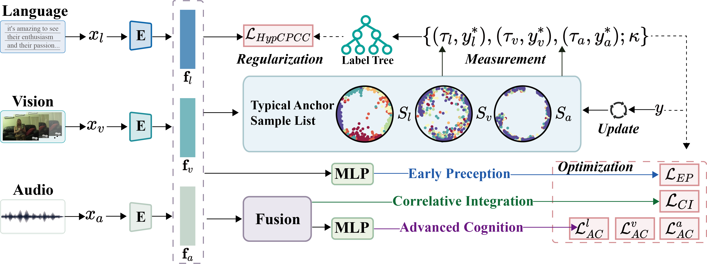

# TiCAL: Typicality-based Inter-modal Consistency-Aware Learning for MER

我们提出面向多模态情感识别（MER）的 **TiCAL**（基于典型性的跨模态一致性感知学习）。TiCAL 的核心思想是：估计各单模态的情感标签并评估其典型性（typicality），从而以动态、分阶段的方式优化模型。

- 我们首先指出 MER 中一个本质性挑战——**跨模态情感冲突（inter-modal emotion conflicts）**，即同一样本内部的不同模态可能传达相互冲突的情感表达。
- 我们提出一种新的范式 **TiCAL**——用于 MER。通过由单模态标签（unimodal labels）与典型性来评估训练样本的不一致性，TiCAL 能够刻画每个模态各自的情感倾向，并以类人（human-like）的情感感知方式调整优化过程。

## 研究动机

<div align=center></img></div>

**问题：**

- 已有方法往往忽视了 MER 中一个固有的基本问题：同一样本内部不同模态之间存在情感表达上的潜在分歧（*跨模态情感冲突*）。
- 我们能否显式地量化并利用跨模态一致性，实现类人的、冲突感知（conflict-aware）的多模态融合情感识别？

**动机：**

- (a) **类人的分阶段框架**：我们提出 TiCAL（Typicality-based Consistency-aware Learning），一个利用跨模态一致性与单模态典型性进行动态多阶段融合的新框架，模拟人类的情感感知过程。
- (b) **可靠的一致性估计**：TiCAL 通过伪标签（pseudo-labels）刻画单模态情感倾向，并引入典型性度量来评估其可靠性，从而在跨模态之间实现稳健且准确的一致性估计。

**核心思想：**

**估计单模态情感标签并评估其典型性，从而借助多模态一致性实现模型的动态、分阶段优化。**

## 模型框架



## 使用方法

### 环境依赖

- Python 3.10
- PyTorch 2.3.1
- CUDA 11.8
- transformers 4.51.1
- networkx 3.4.2
- numpy 1.25.0
- pandas 2.2.3
- wheel 0.45.1

### 数据集

包含已处理好的 MOSI、MOSEI 数据集的数据文件可从[此处](https://drive.google.com/drive/folders/1BBadVSptOe4h8TWchkhWZRLJw8YG_aEi?usp=sharing)下载。
将下载的数据放入 `./dataset` 目录下即可。
请注意：由于 YouTube 内容创作者的隐私原因，元信息（meta information）与原始数据不可获取。更多细节请参考这些数据集的[官方网站](https://github.com/A2Zadeh/CMU-MultimodalSDK)。

### 运行代码

- 训练

首先，你需要在 `./config/config.json` 中设置必要的参数；然后在 `train.py` 中选择要训练的数据集。
训练模型的方式如下：

```
python train.py
```

默认情况下，训练好的模型会保存在 `./pt` 目录下，你也可以在 `train.py` 中修改该路径。

- 测试

测试训练好的模型的方式如下：

```
python test.py
```

请先在 `run.py`（第 174 行）中设置训练好的模型路径。

### 引用

感谢以下论文提供的代码仓库结构：Decoupled Multimodal Distilling for Emotion Recognition。如果本代码对你的研究或工作有所帮助，请引用以下论文：

```
@InProceedings{Li_2023_CVPR,
    author    = {Li, Yong and Wang, Yuanzhi and Cui, Zhen},
    title     = {Decoupled Multimodal Distilling for Emotion Recognition},
    booktitle = {Proceedings of the IEEE/CVF Conference on Computer Vision and Pattern Recognition (CVPR)},
    month     = {June},
    year      = {2023},
    pages     = {6631-6640}
}
```
激活环境：cd /home/ubuntu/tical-new
conda activate tical

运行程序：python train_tmr.py 2>&1 | tee tical_unaligned_mosei_train.log（日志）


