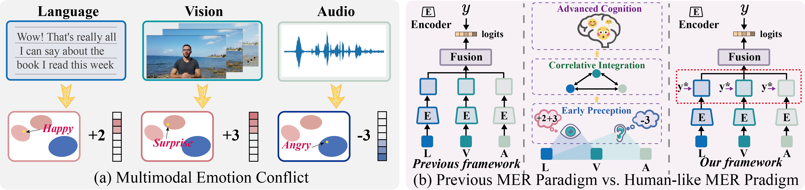

we propose Typicalness-aware MultimodA Consistency learning (TiMER) for MER. he core idea of TiMER is to estimate unimodal emotion labels and evaluate their typicality to enable dynamic, stage-wise optimization of the model.
- We first identify the intrinsic challenge of {inter-modal emotion conflicts} in the  MER, wherein different modalities within the same sample may convey conflicting emotional expressions. 
- We propose a novel paradigm **TiMER**—for MER. By assessing the inconsistency of training samples through diacritic unimodal labels and typicalness, TiMER captures the divergent emotional tendency of each modality and adjusts the optimization as human-like emotion perception.

## The motivation.
<div align=center></img></div>
Problem:

- Previous approaches often overlook a fundamental issue inherent to MER: the potential divergence in emotional expression across different modalities within the same sample (* inter-modal emotional conflicts *). 
- This may introduce ambiguity during training, hinder effective feature learning and ultimately impair the overall performance of MER models.

Motivation: 
- (a) From the perspectives of psychology and neuroscience, the process of perceiving emotions from multiple sources can be divided into three stages: Early Perception (EP), Correlative Integration (CI), and Advanced Cognition (AC). In the EP stage, the brain processes unimodal stimuli and forms initial emotional perceptions, while in the CI and AC stages, it integrates and reconciles these inputs to develop a coherent emotional understanding.
- (b) Can we simulate human-like emotion perception by dynamically modeling modality-specific emotional tendencies and integrating them through consistency-aware fusion?
- (c) Align with the hierarchical nature of human emotional perception and.

Core idea:

**To estimate unimodal emotion labels and evaluate their typicality to enable dynamic, stage-wise optimization of the model by multimodal consistency**.
## The Framework.


## Usage

### Prerequisites
- Python 3.10
- PyTorch 2.3.1
- CUDA 11.8
- transformers 4.51.1
- networkx 3.4.2
- numpy 1.25.0
- pandas 2.2.3
- wheel  0.45.1


### Datasets
Data files (containing processed MOSI, MOSEI datasets) can be downloaded from [here](https://drive.google.com/drive/folders/1BBadVSptOe4h8TWchkhWZRLJw8YG_aEi?usp=sharing). 
You can put the downloaded datasets into `./dataset` directory.
Please note that the meta information and the raw data are not available due to privacy of Youtube content creators. For more details, please follow the [official website](https://github.com/A2Zadeh/CMU-MultimodalSDK) of these datasets.

### Run the Codes
- Training

First, you need to set the necessary parameters in the `./config/config.json`. Then, you can select the training dataset in `train.py`.
Training the model as below:
```
python train.py
```
By default, the trained model will be saved in `./pt` directory. You can change this in `train.py`.

- Testing

Testing the trained model as below:
```
python test.py
```
Please set the path of trained model in `run.py` (line 174).


### Citation
Thank you for the source code repository structure based on Paper Decoupled Multimodal Distilling for Emotion Recognition. If you find the code helpful in your resarch or work, please cite the following paper.
```
@InProceedings{Li_2023_CVPR,
    author    = {Li, Yong and Wang, Yuanzhi and Cui, Zhen},
    title     = {Decoupled Multimodal Distilling for Emotion Recognition},
    booktitle = {Proceedings of the IEEE/CVF Conference on Computer Vision and Pattern Recognition (CVPR)},
    month     = {June},
    year      = {2023},
    pages     = {6631-6640}
}
```


